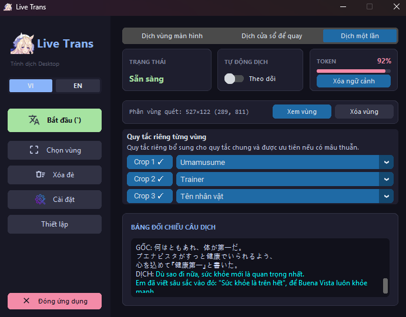
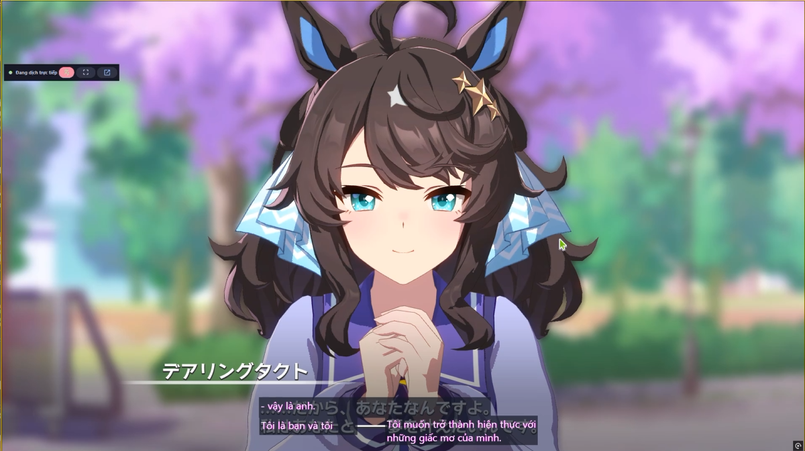
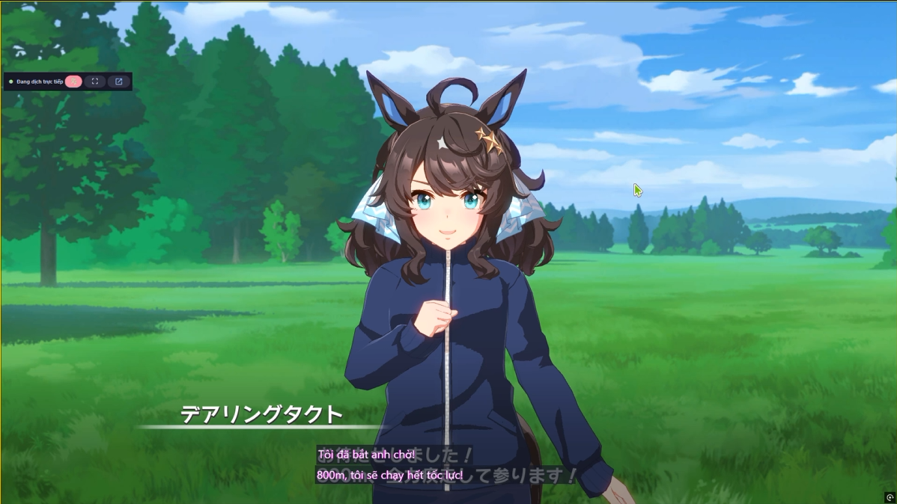

# Live Trans

Live Trans là ứng dụng Windows nhận dạng chữ tiếng Nhật hoặc tiếng Anh trên màn hình và hiển thị bản dịch tiếng Việt ngay tại vị trí chữ gốc. Bạn có thể dùng khi đọc manga, chơi game hoặc xem nội dung có phụ đề.



## Tính năng

- **Dịch màn hình** — quét màn hình chính hoặc giới hạn trong vùng bạn chọn.
- **Dịch cửa sổ** — chọn một cửa sổ cụ thể và có thể khoanh riêng phần hội thoại hoặc phụ đề bên trong.
- **Phụ đề phủ trên màn hình** — xem bản dịch tại vị trí chữ gốc và đối chiếu với văn bản đã nhận dạng trong cửa sổ ứng dụng.
- **Xử lý trên máy** — ảnh chụp và văn bản được xử lý bằng mô hình cục bộ. Sau khi cài đủ thư viện và mô hình, bạn có thể dịch ngoại tuyến.

## Cài đặt và chạy trên Windows

### 1. Cài Python

- Dùng **Windows 10 phiên bản 2004 trở lên hoặc Windows 11**, trên máy x64.
- Cài **Python 3.12 bản 64-bit**. Nếu dùng bộ cài Python 3.12.10, chọn **Windows installer (64-bit)** và giữ các thành phần mặc định gồm `pip`, Tcl/Tk và Python Launcher. [Tải Python 3.12.10](https://www.python.org/downloads/release/python-31210/)
- Chuẩn bị kết nối Internet và dung lượng trống để tải thư viện và mô hình trong lần thiết lập đầu. Ứng dụng có thể chạy trên CPU.

### 2. Tải mã nguồn

**Cách 1 — Tải ZIP**

1. Trên trang GitHub của dự án, bấm **Code → Download ZIP**.
2. Giải nén ZIP và mở thư mục chứa tệp `main.py`.
3. Trong File Explorer, bấm vào thanh địa chỉ của thư mục, gõ `powershell` rồi nhấn Enter để mở PowerShell ngay tại đó.

**Cách 2 — Dùng Git**

Cài [Git cho Windows](https://git-scm.com/install/windows) nếu máy chưa có Git. Mở PowerShell tại thư mục bạn muốn lưu dự án và chạy:

```powershell
git clone https://github.com/wew571/Live-Trans.git
cd Live-Trans
```

### 3. Mở ứng dụng và hoàn tất thiết lập

Chạy lần lượt các lệnh dưới đây. Lệnh đầu cần in ra `Python 3.12.x`.

```powershell
py -3.12 --version
py -3.12 main.py
```

Trong cửa sổ **Thiết lập Live Trans**:

1. Ở mục **Thư viện Python**, bấm **Chọn tất cả** rồi **Cài thư viện đã chọn**. Chờ quá trình cài hoàn tất.
2. Ở mục **Mô hình**, bấm **Chọn tất cả** rồi **Cài mô hình đã chọn**. Nhóm này gồm PP-OCRv6 Small (det và rec), Mitsua ElanMT và VinAI Translate v2.
3. Mục **Mô hình bổ sung** cho phép cài PP-OCRv6 Medium det, PP-OCRv6 Medium rec, NLLB Custom ONNX, NLLB-200 Distilled 600M, các bản Qwen3.5 Q4_K_M (2B, 4B và 9B), Qwen3.8-27B Q4_K_M và runtime llama.cpp dùng chung. Sau khi các mục bắt buộc sẵn sàng, bấm **Tiếp tục** để mở ứng dụng. Bạn có thể mở lại **Thiết lập** từ màn hình chính.

Những lần sau, mở PowerShell tại thư mục dự án và chạy lại `py -3.12 main.py`.

## Cách sử dụng

### Dịch một vùng trên màn hình

1. Chọn **Dịch vùng màn hình**.
2. Bấm **Chọn vùng** rồi kéo chuột quanh đoạn chữ cần dịch. Bấm **Toàn màn hình** để quay về chế độ quét cả màn hình chính.
3. Bấm **Bắt đầu** và chờ bản dịch xuất hiện.

### Dịch trong một cửa sổ

1. Chọn **Dịch cửa sổ để quay** rồi bấm **Chọn cửa sổ** và chọn ứng dụng nguồn.
2. Nếu chỉ cần dịch hộp thoại hoặc phụ đề, bấm **Chọn vùng** rồi kéo chuột trong cửa sổ nguồn. Dùng **Toàn cửa sổ** để bỏ giới hạn vùng.
3. Bấm **Bắt đầu** rồi chuyển sang cửa sổ nguồn để xem phụ đề. Với game, hãy dùng chế độ cửa sổ hoặc cửa sổ không viền.

Phím backtick (`` ` ``) dùng để bắt đầu hoặc dừng dịch. Bấm **Xóa đè** để xóa phụ đề đang hiển thị hoặc **Hủy** để thoát thao tác chọn vùng.

### Dịch nhiều vùng và giữ ngữ cảnh

Chọn từ một đến ba vùng trong **Cài đặt**. Trên màn chính, chọn vùng theo thứ tự và dùng khung xem trước để kiểm tra vị trí. Bạn có thể sửa từng vùng riêng. Vùng trống hoặc chưa đổi chữ được bỏ qua, còn bản dịch mới hiện ngay tại vùng tương ứng.

Với **High** trở lên, các vùng dùng chung một phiên Qwen. Để Crop 1 đọc tên nhân vật, tạo slot quy tắc có dòng đầu là `Vai trò: Tên người nói` rồi gán slot đó cho Crop 1. Crop 2 mặc định xử lý lời thoại và dùng tên đã đọc khi dịch. Có thể viết `Vai trò: Lời thoại` để chỉ định rõ vai trò này trong một slot. Khi có chỉ dẫn khác nhau, quy tắc riêng được ưu tiên cho vùng đang dịch.

Ngữ cảnh mặc định giữ hai lượt thoại gần nhất, gồm tên người nói, câu gốc và bản dịch. Trong **Cài đặt**, bạn có thể tăng lên ba lượt hoặc tắt lịch sử. Dùng **Xóa ngữ cảnh** trên màn chính khi bắt đầu đoạn hội thoại mới.

### Chọn mức dịch

Trong **Cài đặt**, chọn mức bằng thanh trượt.

- **Flash** dùng OCR Small cho cả det và rec, Mitsua ElanMT và VinAI Translate v2.
- **Medium** dùng PP-OCRv6 Medium det và Small rec. NLLB Custom ONNX dịch trực tiếp Nhật → Việt, còn VinAI Translate v2 dịch Anh → Việt. Theo model card, NLLB Custom ONNX **chỉ dành cho mục đích nghiên cứu**. Tải **NLLB Custom ONNX** và **PP-OCRv6 Medium det** trong **Thiết lập** nếu chưa có. [Điều kiện sử dụng NLLB Custom ONNX](https://huggingface.co/belumind/nllb-trilingual-en-vi-ja-onnx#license)
- **High** dùng OCR Medium cho cả det và rec, rồi dùng Qwen3.5-2B Q4_K_M để dịch trực tiếp cả tiếng Nhật lẫn tiếng Anh sang tiếng Việt.
- **Ultra** dùng OCR Medium cho cả det và rec, rồi dùng Qwen3.5-4B Q4_K_M để dịch trực tiếp cả tiếng Nhật lẫn tiếng Anh sang tiếng Việt.
- **Extreme** dùng OCR Medium cho det và rec, với Qwen3.5-9B Q4_K_M để dịch Nhật → Việt hoặc Anh → Việt.
- **Ultimate** dùng OCR Medium cho det và rec, với Qwen3.8-27B Q4_K_M để dịch Nhật → Việt hoặc Anh → Việt.

Mục **Nâng cao** cho phép chọn riêng det, rec và model Nhật → Anh khi dùng luồng trung gian. **Flash** dịch Nhật → Anh → Việt, còn **Medium** dịch Nhật → Việt trực tiếp. Cả hai gửi đầu vào tiếng Anh thẳng tới VinAI. **High**, **Ultra**, **Extreme** và **Ultimate** dùng chung tùy chọn context từ **1.000 đến 25.000 token**, mặc định **3.000**, và cùng thư viện quy tắc. Context lớn hơn có thể cần thêm VRAM.

Trong luồng Qwen, **Nâng cao → Backend Qwen** mặc định dùng **llama.cpp Vulkan**. Để thử **llama-cpp-python CUDA**, cài mục bổ sung **llama-cpp-python CUDA (Qwen)** trong **Thiết lập**, rồi chọn backend và bấm **Lưu**. Backend CUDA dùng lại model GGUF hiện có và cần GPU NVIDIA, PyTorch có thư viện CUDA 13 cùng đủ VRAM cho model và OCR.

Trong luồng Qwen, mở **Quản lý quy tắc** để lưu từng bộ quy tắc theo slot có tên. Chọn slot hoặc chọn **Không dùng quy tắc**, rồi bấm **Lưu** trong **Cài đặt** để áp dụng ở lần **Bắt đầu** tiếp theo. Các slot được lưu cục bộ trong `models/live-ocr/qwen-rules/`.

Khi Cài đặt báo thiếu model hoặc runtime, đóng cửa sổ đó, mở **Thiết lập** từ màn hình chính rồi tải các mục được liệt kê. Quay lại **Cài đặt** để chọn và lưu mức. Nếu đang dịch, Live Trans dừng phiên hiện tại và dùng cấu hình đã lưu ở lần **Bắt đầu** tiếp theo.

Mục **Giao diện** có hai chế độ. **Tối giản** là mặc định và mở cửa sổ Cài đặt trực tiếp trong app. **Nâng cao** mở giao diện WebView2 với công tắc **Animation**. Sau khi bấm **Lưu**, cửa sổ dùng giao diện đã chọn ở lần mở tiếp theo.

Chế độ **Nâng cao** dùng thư viện tùy chọn **pywebview**, cài trong mục **Thư viện Python** của **Thiết lập**, và **Microsoft Edge WebView2 Runtime**. Nếu máy thiếu runtime, có thể cài từ [Microsoft](https://developer.microsoft.com/microsoft-edge/webview2/#download-section). Giao diện dùng các file đi kèm app và chạy offline. Nếu WebView2 chưa sẵn sàng, app mở cửa sổ Cài đặt trực tiếp.

## Ảnh minh họa

Phụ đề tiếng Việt hiển thị trên lời thoại tiếng Nhật trong game.

 

## Xử lý lỗi thường gặp

- **PowerShell báo không nhận lệnh `py`** — đóng và mở lại PowerShell sau khi cài Python. Nếu vẫn lỗi, chạy lại bộ cài Python để bật Python Launcher.
- **Không tìm thấy `main.py`** — mở đúng thư mục đã giải nén rồi gõ `powershell` ở thanh địa chỉ. Bạn có thể dùng `Get-ChildItem main.py` để kiểm tra.
- **Tải thư viện hoặc mô hình bị gián đoạn** — kiểm tra mạng và dung lượng ổ đĩa, sau đó dùng **Thử lại** trong cửa sổ thiết lập.
- **Bản dịch đầu tiên xuất hiện chậm** — ứng dụng cần nạp mô hình. Thu hẹp vùng quét quanh phần chữ cần dịch để giảm lượng hình ảnh phải xử lý.
- **Không thấy phụ đề ở chế độ cửa sổ** — khôi phục cửa sổ nguồn nếu đang thu nhỏ và đưa nó lên trước. Nếu bố cục thay đổi sau khi chỉnh kích thước, hãy chọn lại vùng.

## Mô hình và giới hạn

1. **PP-OCRv6** phát hiện vùng chữ và đọc nội dung trong ảnh. Mặc định dùng Small cho cả hai bước. [PaddleOCR](https://github.com/PaddlePaddle/PaddleOCR)
2. **Mitsua ElanMT** hoặc **NLLB-200 Distilled 600M** dịch tiếng Nhật sang tiếng Anh. NLLB là lựa chọn bổ sung, tải khoảng 2,46 GB trọng số khi chưa có trong bộ nhớ đệm. Meta phát hành NLLB theo giấy phép **CC BY-NC 4.0** cho mục đích nghiên cứu. [Mitsua ElanMT](https://huggingface.co/Mitsua/elan-mt-bt-ja-en) · [NLLB-200 Distilled 600M](https://huggingface.co/facebook/nllb-200-distilled-600M)
3. **VinAI Translate v2** dịch sang tiếng Việt từ văn bản tiếng Anh gốc hoặc từ kết quả Nhật → Anh của model đã chọn. Trọng số model được phát hành theo giấy phép **AGPL-3.0**. [VinAI Translate v2 trên Hugging Face](https://huggingface.co/vinai/vinai-translate-en2vi-v2)
4. **Qwen Q4_K_M** chạy cục bộ qua llama.cpp. App chỉ gửi text từ OCR và yêu cầu tắt thinking. Các tệp GGUF nằm trong `model/`, khoảng 1,31 GB cho 2B, 3,03 GB cho 4B, 5,68 GB cho 9B và 19,4 GB cho 27B. [2B của SoAIHQ](https://huggingface.co/SoAIHQ/Qwen3.5-2B-GGUF) · [4B của ggml-org](https://huggingface.co/ggml-org/Qwen3.5-4B-GGUF) · [9B của Unsloth](https://huggingface.co/unsloth/Qwen3.5-9B-GGUF) · [27B của ggml-org](https://huggingface.co/ggml-org/Qwen3.8-27B-GGUF)
5. **NLLB Custom ONNX** dùng bản INT8 chạy trên CPU qua ONNX Runtime, tải khoảng 1,9 GB. Model card ghi chỉ dùng cho nghiên cứu. [NLLB Custom ONNX trên Hugging Face](https://huggingface.co/belumind/nllb-trilingual-en-vi-ja-onnx)

Chữ nhỏ, phông cách điệu hoặc nền phức tạp có thể làm OCR đọc sai và ảnh hưởng đến bản dịch. Văn bản chỉ có chữ Hán có thể được nhận nhầm là tiếng Nhật. Tốc độ phụ thuộc vào phần cứng và vùng quét. Ứng dụng dùng GPU khi PyTorch nhận được CUDA tương thích.

## Cấu hình tùy chọn

Bạn có thể tạo tệp `.env` trong thư mục chứa `main.py` để đặt các biến sau:

- `LIVE_CAPTURE_FPS` đặt tốc độ chụp màn hình thành `30` (mặc định) hoặc `60`.
- `HF_HOME` hoặc `HF_HUB_CACHE` đổi vị trí lưu mô hình dịch. Mặc định, mô hình dịch nằm trong `models/hub/` và mô hình OCR nằm trong `models/live-ocr/`.
- `LIVE_PYTHONPATH` chỉ định đường dẫn đến bộ thư viện xử lý riêng. Nếu dùng tùy chọn này, hãy cài các gói xử lý vào đường dẫn đã chọn.

### Cài thư viện thủ công

Nếu cần cài bằng dòng lệnh, chạy các lệnh sau trong thư mục dự án rồi mở lại `main.py` để thiết lập mô hình.

```powershell
py -3.12 -m pip install -r requirements.txt
py -3.12 -m pip install --no-deps -r requirements-nodeps.txt
py -3.12 -m pip install --target models/live-runtime -r requirements-live.txt
py -3.12 main.py
```

## Cấu trúc dự án

- [`main.py`](main.py) kiểm tra thiết lập và mở ứng dụng.
- [`frontend/`](frontend/) chứa giao diện, công cụ chọn vùng và lớp phụ đề.
- [`core/`](core/) xử lý chụp cửa sổ, OCR, dịch và tải mô hình.
- [`tests/`](tests/) chứa các bài kiểm thử cho luồng thiết lập và dịch trực tiếp.

## Ghi nhận nguồn


VinAI Translate được giới thiệu trong bài báo *A Vietnamese-English Neural Machine Translation System* của Nguyen và cộng sự, INTERSPEECH 2022. [Thông tin trích dẫn](https://huggingface.co/vinai/vinai-translate-en2vi-v2)
